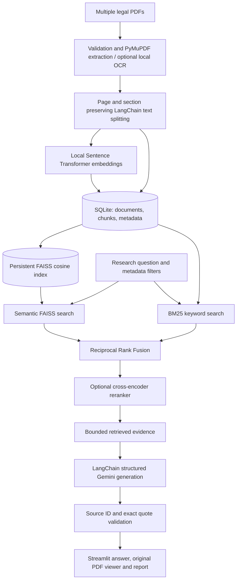

> Historical record from before the three-section refactor. UI routes and commands here may refer to removed screens or scripts. See [README.md](README.md) and [REFACTOR_VALIDATION.md](REFACTOR_VALIDATION.md) for the current app.

# LexiRAG

**Multi-Document Legal Research Assistant Using Retrieval-Augmented Generation (RAG)**

A functional Python 3.11+ / Streamlit project for advanced B.Tech AI coursework and local demonstrations, focused on research across uploaded Indian legal materials. Upload judgments, acts, contracts and case studies; retrieve across them; ask Gemini for cited explanations; inspect original PDF pages; compare documents; summarize long files; export reports; and run measured retrieval experiments.

LexiRAG is a research assistant, not a replacement for professional legal advice. It searches the documents you upload; it is not a live case-law database or a source of verified current law. Verify authenticity, amendments, procedural history and precedential status independently.

## Quick start (Windows PowerShell)

```powershell
cd C:\Users\Swarnalata\Desktop\RAG
py -3.11 -m venv .venv
.\.venv\Scripts\Activate.ps1
python -m pip install -r requirements.txt
Copy-Item .env.example .env
```

If PowerShell blocks virtual-environment activation, use `.\.venv\Scripts\python.exe` in place of `python`; changing the system execution policy is unnecessary.

1. Obtain a Gemini API key from [Google AI Studio](https://aistudio.google.com/apikey).
2. Edit `.env` and set `GOOGLE_API_KEY=your_key`. Do not put the key in Python source or commit `.env`.
3. Set `GEMINI_MODEL` to a model enabled for your API project. The supplied example is `gemini-3.5-flash-lite`; model access and quotas vary. Check [Google's model catalog](https://ai.google.dev/gemini-api/docs/models) if the API reports an unavailable model.
4. Launch:

```powershell
python -m streamlit run app.py
```

Open the local URL shown in the terminal, normally `http://localhost:8501`. Use **Upload Documents** to ingest PDFs before researching them. API configuration changes require restarting Streamlit. Basic library browsing, keyword search, extraction, embedding and semantic/hybrid search do not require a Gemini key. First embedding/reranking use downloads model weights from Hugging Face; subsequent use runs locally on CPU.

Linux/macOS equivalent:

```bash
python3.11 -m venv .venv
source .venv/bin/activate
python -m pip install -r requirements.txt
cp .env.example .env
# Edit .env
python -m streamlit run app.py
```

Use a separate environment for this project. Dependencies have bounded major versions; `requirements-lock.txt`, when present, records the exact validated environment. For that exact environment, install it with `python -m pip install -r requirements-lock.txt`. CPU PyTorch and local model caches need appreciable disk space and RAM (several GB for the complete environment). Python 3.11 is the tested target; binary-wheel availability can differ on newer Python releases.

## Features and interface

| Workspace | Implemented behavior |
| --- | --- |
| Dashboard | Actual document/page/chunk/query counts, category charts, recent activity and saved experimental retrieval metrics. Empty state until data exists. |
| Upload Documents | Multiple PDFs; extension/header/size/page/password validation; PyMuPDF extraction; explicit section labels; optional OCR; page-preserving chunks; SHA-256 duplicate detection; persistent SQLite/FAISS; library, viewer and deletion. Metadata is supplied by the user and never inferred from an unreliable date. |
| Legal Research Assistant | Chat interface, independent evidence retrieval per turn, configurable top-K, filters and reranking, structured facts/interpretations, evidence limitations, verified quote/source references and report export. |
| Document Comparison | Independent hybrid retrieval per selected document, fair context allocation, evidence-linked comparison table and export. No assumption of overruling or conflict. |
| Document Summarization | Executive summary, facts, issues, provisions, findings and dates when supported; hierarchical evidence compression for long documents; original-page citations. |
| Advanced Search | Semantic, keyword or hybrid search; document/category/jurisdiction/verified legal-date filters; raw cosine, BM25, RRF and reranker scores. |
| Evaluation and Analytics | Human-label JSONL ingestion, semantic/hybrid/reranked comparison, Precision@K, Recall@K, MRR, latency, optional Gemini refusal/provenance scoring and Ragas faithfulness/citation correctness; saved tables and charts. |
| Settings | Config status without revealing the key; index recovery; individual and bulk data removal. |

### Example research questions

- Which uploaded judgments discuss the right to privacy, and what reasoning do they give?
- What are the important provisions of this uploaded act?
- Summarize the facts, legal issues and findings in the selected Supreme Court judgment.
- Which passages address informed consent and withdrawal of consent?
- Compare the legal reasoning in these two selected cases on the specified issue.
- What termination and notice provisions differ between these agreements?
- What dates are expressly mentioned in this document?
- Do the uploaded documents contain enough evidence to answer this question?

Include a document or case name and the issue in follow-up questions. Earlier generated answers are not evidence and are not automatically carried into the next retrieval query. Scope questions with document filters when necessary. Comparison accepts two to eight documents; summarization explicitly selects one.

### Source viewer and reports

Each accepted finding links to a retrieved source ID, document name, **PDF file page number**, explicit section/numbered-block label when detected, and an exact supporting quotation. The evidence workspace shows full retrieved passages. “Inspect original PDF page” opens an on-demand rendering from the original PDF with page navigation and full-PDF download. This works without browser PDF plugins; printed reporter page numbers can differ from file pages.

PDF/Markdown reports contain the research question, accepted findings, supporting quotes, full cited passages, comparison results when applicable, and limitations. Unicode font support uses Arial on Windows or DejaVu Sans on Linux when available; arbitrary Indic scripts may require a suitable font and shaping support beyond the default export. Inspect the original PDF for language-specific typography.

## Architecture



**Ingestion:** SHA-256 of the original PDF identifies duplicates. Chunks never cross file pages; explicit section/article/paragraph/clause markers are retained conservatively. LangChain's maintained recursive splitter respects paragraph and sentence boundaries where possible. `all-MiniLM-L6-v2` provides normalized local English embeddings; default chunks are 900 characters with 120 overlap, keeping typical English legal passages near its token budget. Character bounds cannot guarantee token bounds for unusually dense text; model truncation is a limitation. SQLite stores source records and normalized float32 embedding blobs in one transaction. FAISS uses exact inner product on normalized vectors, which yields cosine similarity. No pickle index files are loaded.

**Persistence and recovery:** SQLite is authoritative. A corpus file lock serializes ingestion/deletion and retrieval snapshots. The FAISS manifest records model, SQLite revision, dimension, chunk order and file checksum. Missing/stale/corrupt indexes rebuild from SQLite embeddings without another model download. Atomic replacement prevents partly written artifacts. Deletion removes the source file and cascades chunk/vector deletion, invalidates FAISS, and rebuilds remaining documents. Filters run before ranking; filtered semantic search builds an exact FAISS subindex from the eligible stored vectors so relevant filtered results are not lost through post-filtering. Changing embedding models requires re-ingestion, not merely rebuilding FAISS.

**Retrieval:** Semantic and BM25 candidates each retrieve `max(4K, 20)` eligible passages, bounded by corpus size. RRF scores each result by the sum of `1 / (60 + rank)` across lists. BM25Okapi uses a positive 0.01 IDF floor for very common terms to retain exact matches in small corpora. Optional `cross-encoder/ms-marco-MiniLM-L6-v2` scores the candidate query-passage pairs. It reranks candidates, not the whole corpus. Top-K passages then enter a character-bounded model context. Scores are method-specific relevance signals, never calibrated legal-confidence probabilities.

**Generation:** LangChain `ChatPromptTemplate | ChatGoogleGenerativeAI.with_structured_output(..., method="json_schema")` uses maintained runnable APIs, not deprecated RetrievalQA chains. Gemini receives only the question, guidance and selected untrusted evidence. Structured findings distinguish facts from interpretations. The system asks for evidence insufficiency when appropriate. An empty retrieval result never triggers a general-knowledge answer. Whole findings are withheld if any evidence ID or exact quote cannot be verified. Valid source identity and quote presence do not prove that a legal interpretation follows; inspect source passages and use semantic/human evaluation.

**Comparison:** Every selected document is queried independently. Passages enter the context in round-robin order. Comparison requires at least one passage from each selected document and labels table cells with no cited support. The generation prompt requires support for each document discussed and prohibits inferring conflict/precedential priority from silence. Judicial hierarchy and treatment of precedent are not automatically verified.

**Long summaries:** Map bounded groups of all indexed chunks into cited findings, retain supporting verbatim excerpts, and recursively reduce evidence groups until a final generation fits. Original labels and page metadata persist through all stages. Final quotations are validated against original chunks. Summary compression can omit detail and is disclosed. If evidence fails to shrink safely, the app returns an actionable error instead of silently truncating the document.

## Project layout

```text
app.py                       Streamlit entry point and navigation
config/settings.py           .env configuration and limits
core/
  models.py                  Typed source, retrieval and answer records
  document_processor.py      PDF validation, extraction, OCR, section chunking
  embeddings.py              Lazy local Sentence Transformer/cross-encoder models
  vector_store.py            Persistent FAISS and recovery manifest
  keyword_search.py          BM25 tokenization and ranking
  hybrid_retriever.py        Filters, semantic/keyword/hybrid/RRF/reranking
  service.py                 Corpus lifecycle and persistence coordination
  rag_pipeline.py            LangChain/Gemini evidence-grounded answers
  citation_manager.py        Exact quote and source validation
  document_comparison.py     Independent per-document evidence and table
  summarizer.py              Hierarchical cited document summaries
database/store.py            SQLite schema, transactions and real analytics
ui/components.py             Styling, evidence rendering, PDF source viewer, export
ui/views.py                  Eight functional workspace views
utils/reports.py             PDF and Markdown research reports
evaluation/                  Metrics, dataset validation, CLI runner and protocol
scripts/create_demo.py       Explicitly synthetic PDF fixtures and optional indexing
tests/                       Offline unit, integration and Streamlit smoke tests
data/                        Private runtime PDFs, SQLite, indexes and experiments
```

The `ui/` package keeps presentation modular without Streamlit's automatic `pages/` navigation competing with the requested sidebar. Standard-library SQLite is the only metadata database; no web server framework or orchestration service is introduced.

## Configuration

All keys belong in `.env` or process environment variables. `.env.example` documents the full set. `LEXIRAG_DATA_DIR` may point to another local storage directory. Restart after changing environment settings. Limit fields reject invalid chunk/context/upload settings. Increase Streamlit's `.streamlit/config.toml` `maxUploadSize` as well as `MAX_UPLOAD_MB` if raising the upload cap.

Optional OCR uses PyMuPDF's Tesseract integration; it needs a separately installed Tesseract engine and `eng.traineddata` (or your chosen languages). Set `TESSDATA_PREFIX` to the language-data directory if needed. Enable OCR on upload; suspected scans are image-containing pages with little extracted text. This heuristic can miss unusual scans or flag image-heavy pages. Mixed PDFs remain usable without OCR, with missing-page warnings; wholly unreadable PDFs are rejected. OCR text can contain errors, so verify the original page.

Model weights are cached under the configured data directory's `model_cache/hub/` by default. An existing `HF_HOME` overrides this location. For a real local model integration check, run `python -m scripts.smoke_local`; it uses temporary synthetic documents and checks embedding, semantic/keyword/hybrid retrieval and cross-encoder reranking without a Gemini key.

## Privacy, security and reliability

- Original PDFs, text, embeddings and metadata persist locally. `.gitignore` excludes `.env`, runtime data, SQLite files, logs and private experiment outputs.
- Gemini generation sends selected excerpts and the question to the external provider; hierarchical summarization can send excerpts from the entire document across calls. Optional Ragas judging also sends answer statements and evidence. Review provider terms before using confidential data. Gemini usage can incur charges.
- No credentials are accepted in UI fields or hardcoded. The Settings page shows only whether a key exists. Application activity records omit questions, answers and passages. Prompt tracing is disabled in the app.
- Retrieved text is untrusted data. It has no tool access and is not executable; prompts instruct Gemini to ignore embedded commands. Prompt injection and model hallucination cannot be eliminated completely by prompting.
- Uploads are validated, saved under generated hashes, and never used as filesystem paths from client filenames. Parameterized SQLite queries handle filters. API failures expose a generic actionable message without provider exception text.
- Individual deletion removes PDFs, chunk records, vectors and index entries. Bulk deletion also clears activity and stored experiments. Session results referencing deleted documents are hidden. Downloaded reports, annotation exports, backups, browser caches and provider-side data are not remotely deleted; these remain under your control. Filesystem/SQLite deletion is logical removal, not forensic secure erasure.
- Use as a trusted **local, single-user** research application. There is no authentication, tenancy separation, encrypted-at-rest database, antivirus sandbox or internet deployment hardening. Do not expose the Streamlit port publicly for confidential uploads.
- Unknown jurisdiction/legal dates remain unknown; upload time is never substituted for a legal date. Manual metadata reflects user input and must be checked.

## Tests and evaluation

```powershell
python -m pytest
python -m compileall -q app.py config core database evaluation ui utils scripts
python -m pip check
```

Tests generate PDFs in temporary directories, exercise real SQLite/FAISS/BM25 and use deterministic **test-only** embeddings and mocked Gemini/reranker behavior. They test page fidelity, section extraction, malformed/blank/scanned/encrypted PDFs, limits, transaction rollback, duplicate suppression, deletion, persistent/corrupt indexes, filtered retrieval, citation rejection, hierarchical summary coverage, report readability, metric definitions, dataset validation and every Streamlit route. They do not claim to validate live Gemini accuracy or real-law performance.

The separate, opt-in `python -m scripts.check_live_workflows` runner exercises all eight user workflows through Streamlit AppTest with **real Gemini calls** and cached local models. It uploads synthetic teaching agreements to `data/live-checklist/corpus/`, preserves the main library, and saves responses, verified citations, original-page/report previews, an exported PDF, labels and measured evaluation results. API usage applies. See [LIVE_TEST_RESULTS.md](LIVE_TEST_RESULTS.md) for the completed run and its limits.

For actual experiments and dataset definitions, read [evaluation/README.md](evaluation/README.md). Install `requirements-eval.txt` for Ragas. Answer judging uses Gemini, and absence of a key never produces fabricated faithfulness scores. The dashboard starts without benchmark scores and marks experiments from older corpus revisions.

Generate optional synthetic teaching PDFs for a self-contained demonstration:

```powershell
python -m scripts.create_demo
# Upload the PDFs in data/demo/ using the app, or index with actual local embeddings:
python -m scripts.create_demo --index
python -m evaluation.runner data/demo/fixture-questions.jsonl --k 3 --modes semantic hybrid
```

These fictional agreements demonstrate pipeline behavior and are clearly labeled as synthetic. They are not Indian legal authorities. Upload authentic legal materials you are authorized to use for your academic demonstration and annotate a separate evaluation corpus.

## Troubleshooting and practical limits

| Problem | Action |
| --- | --- |
| Missing key or model access | Set `GOOGLE_API_KEY` and an enabled `GEMINI_MODEL`; restart. Check quotas and model access in AI Studio. |
| Local model won't download | Allow Hugging Face access on first use; verify model ID, proxy and disk space. Cache or provide a local model path for later offline use. Keyword search still works on ingested documents without loading an encoder. |
| Scanned PDF has no text | Install Tesseract plus language data and enable OCR. Inspect original pages for recognition errors. |
| FAISS files are missing/corrupt | Search automatically rebuilds them from SQLite, or use Settings → Rebuild FAISS. Back up SQLite and uploads together. |
| Embedding-model mismatch | Restore the original model setting or delete and re-ingest PDFs with the new model. |
| Generic operation error | Check available memory, disk permissions, dependency compatibility and file integrity. App logs record exception types without private payloads. |
| Too many summary requests | Large files require multiple calls; reduce file size or adjust context budget and API quota. No API-free generated summary is substituted. |
| Poor retrieval or refusal | Improve document text/OCR and question specificity, adjust top-K, inspect retrieval scores, compare keyword/hybrid/reranking, and evaluate with gold labels. |

The default embedding and reranking models target English. Indian-language PDFs require a suitable local multilingual model, OCR language packs, corpus re-ingestion and a separate quality evaluation. Table-heavy PDFs, complex columns, handwriting and mathematical/legal formatting may extract imperfectly. SQLite/flat FAISS and rebuilding after deletion favor coursework-scale corpora over millions of passages. Summary/request context is bounded by characters, not exact provider tokens. A valid quotation does not certify the model's legal reasoning. No automatic amendment tracking, legal-date verification, citation-network analysis or authoritative judicial-treatment service is included.

## Maintained API references

- [LangChain Gemini integration and native structured output](https://docs.langchain.com/oss/python/integrations/chat/google_generative_ai)
- [Sentence Transformers query/document encoding](https://www.sbert.net/docs/package_reference/sentence_transformer/model.html)
- [Sentence Transformers cross-encoder API](https://www.sbert.net/docs/package_reference/cross_encoder/model.html)
- [PyMuPDF OCR support](https://pymupdf.readthedocs.io/en/latest/recipes-ocr.html)
- [Ragas collections faithfulness metric](https://docs.ragas.io/en/stable/concepts/metrics/available_metrics/faithfulness/)
- [Ragas Gemini integration and compatibility guidance](https://docs.ragas.io/en/stable/howtos/integrations/gemini/)
- [Gemini API models](https://ai.google.dev/gemini-api/docs/models)

